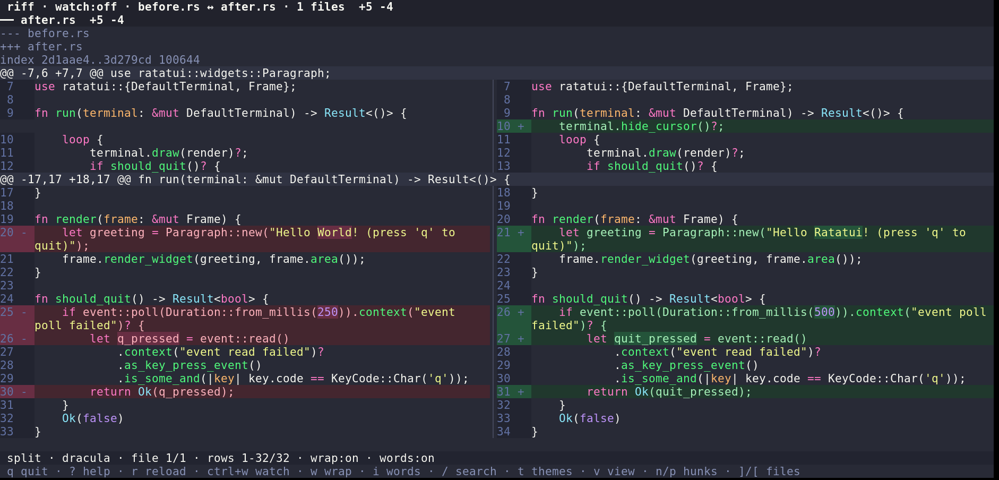

# riff

A read-only terminal diff viewer for Git changes, commits, file pairs, and
unified patches. Review code with syntax highlighting, clear change backgrounds,
and a keyboard-driven interface.

- Split and unified layouts, with automatic selection for your terminal width.
- Changed-word backgrounds that preserve syntax colors and subtle line tints.
- File/hunk navigation, live literal search, horizontal scrolling, and word wrap.
- Ten built-in themes, live theme previews, and custom TOML palettes.
- Manual reload and native filesystem watching for Git and file sources.
- Numbered plain-text or ANSI output when you do not need the interactive UI.



Dracula theme, split view, and word wrapping with illustrative edits

## Install from source

Requires **Rust 1.93.1 or newer** and Cargo. This is the declared and currently
tested Rust baseline. Install native build tools (including a C compiler) for
dependencies. **Git** must be on `PATH` for Git sources and two-file comparisons;
stdin patches do not require Git. A truecolor terminal is recommended.

```sh
git clone https://github.com/jhargis/riff.git
cd riff
cargo build --release --locked
./target/release/riff --help
```

You can use the local executable directly. For an optional user-local installation
into Cargo's bin directory (normally `~/.cargo/bin`), run from the checkout:

```sh
cargo install --path . --locked
```

The examples below assume `riff` is on `PATH`; otherwise use the local executable.
Installation is from source, not crates.io: this package has `publish = false`.

## Common usage

Run Git examples inside the repository you want to review.

```sh
riff                              # unstaged tracked changes, with terminal stdin
riff --staged                     # staged changes
riff HEAD~1                       # changes introduced by this commit
riff src/main.rs                  # unstaged changes for a file, relative to cwd
riff src                          # unstaged changes under a directory
riff -- src tests                 # unstaged changes for several paths
riff --staged -- src              # staged changes under a path
riff --commit HEAD -- src/main.rs  # commit changes filtered to a path
riff --files before.rs after.rs    # compare two files, even outside a repository
git diff --no-color | riff         # read a patch from piped stdin
riff --stdin < change.patch        # explicitly read a patch until EOF
riff --print --staged              # numbered unified output, without the TUI
riff --staged --color always > changes.txt
riff --theme "one dark" --view split
riff --wrap --watch                # wrap code and refresh on changes
riff --no-wrap --no-watch          # one-run overrides of saved preferences
riff --no-word-diff                # line-level colors only for this run
riff --list-themes
riff --help
```

A bare argument can be a path or a commit-resolving revision. If it names both,
use `riff -- NAME` for the path or `riff --commit NAME` for the revision.
Use `--` for multiple paths or staged/commit path filters.

**Without an explicit source, non-terminal stdin is treated as a patch.**
Explicit Git/file sources and path filters take precedence over piped stdin.
Non-terminal stdout always prints instead of opening the TUI. For complete
source/path rules and one-shot behavior, see the [usage reference](docs/usage.md).

## Controls

| Keys | Action |
| --- | --- |
| `j/k`, `↓/↑`, mouse wheel | Scroll |
| `PgDn/PgUp`, `Space/Shift-Space` | Page down / up |
| `Ctrl-D/Ctrl-U` | Half page down / up |
| `g/G`, `Home/End` | First / last row |
| `h/l`, `←/→`; `0` | Horizontal scroll; reset horizontal offset |
| `n/p`; `]/[` | Next / previous hunk; next / previous file |
| `/` | Live, case-insensitive literal search |
| `Enter/Shift-Enter`, `F3/Shift-F3` | Next / previous search match |
| `t` | Theme preview; Enter accepts, Esc cancels |
| `v`; `w` | Toggle and save layout; toggle and save word wrap |
| `i` | Toggle and save changed-word backgrounds |
| `ctrl+w` (no Shift) | Toggle and save automatic watching |
| `r`, `Ctrl-R` | Reload the original Git/file source |
| `?` | Help |
| `q`, `Ctrl-C` | Quit |

Riff requests Kitty/CSI-u keyboard enhancements. Legacy terminals may send the
same byte for Space and Shift-Space; use PgUp or Ctrl-U to page up there.
See [all controls and wrapping behavior](docs/usage.md#interactive-controls).

## Themes and configuration

Built-ins: **critique** (default), dracula, catppuccin (Mocha), nord, gruvbox
(dark), sunset, one-dark, monokai, hacker-term, and github-dark. Names are
case-insensitive and ignore spaces, hyphens, and underscores.

Theme precedence is `--theme NAME` → `RIFF_THEME` → config `theme` → `critique`.
Layout defaults to `auto` (split at 100 columns); wrapping and watch default to
off. Word highlighting defaults to on; `--word-diff` / `--no-word-diff`
override config `word_diff` for one run. Token backgrounds use the selected
palette, including blue additions in github-dark. CLI options override saved settings for one run.

Default configuration locations:

- Linux/other Unix: absolute, nonempty `$XDG_CONFIG_HOME/riff/config.toml`,
  otherwise `~/.config/riff/config.toml`; relative XDG paths are ignored.
- macOS: `~/Library/Application Support/riff/config.toml`.
- Windows: roaming AppData, normally `%APPDATA%\riff\config.toml`.

A missing default config is fine. `--config PATH` selects an existing file for
both reading and saving. Only accepted interactive changes save preferences:
theme-picker Enter, `v`, `w`, `i`, and an acknowledged `ctrl+w` toggle each save
only that setting. Startup, CLI overrides, previews, print, and quit alone do
not write config.

See [configuration and custom palettes](docs/configuration.md) and the
[example config](examples/config.toml). Unknown keys, invalid colors/types,
and unknown or conflicting theme names are errors.

## Watch and reload

Watching uses native filesystem events, not periodic Git polling. `ctrl+w`
(lowercase w, without Shift) remembers watch mode; `--watch` and `--no-watch` override it for one run.
Manual reload works with watching off. Reload keeps the original source,
directory, and path filters, preserving reading position and search where
possible. Errors retain the last valid diff.

Stdin patches cannot be reread. Explicit `--watch` with stdin, `--print`, or
non-terminal stdout is rejected; saved watch mode is ignored for those sources.
An initially empty watched diff stays open. Filesystems with unreliable events
may need manual reload. See [watch details and limits](docs/usage.md#watch-and-reload).

## Input, output, and limits

- Standard unified and Git patches are supported; patch contents and filenames
  must be UTF-8. Git commit sources show first-parent changes for merge commits;
  combined merge patches supplied as input are rejected.
- Unstaged/staged sources use Git diffs, not an untracked-file browser.
  Rename, mode, and binary metadata is shown, but binary bodies are not decoded.
- Printed output is a **numbered unified view**, not a patch for `git apply`.
  Both differences and no differences exit **0**; errors exit nonzero.
  `--color auto|always|never` controls printed ANSI colors, not TUI colors.
- Syntax highlighting includes TypeScript/TSX. Unknown languages use plain text;
  omitted hunk context can make multiline highlighting best effort.
  `--no-syntax` keeps diff colors without grammar highlighting.
- Word edits emphasize whole tokens (`30` → `60`, not just `3` → `6`) without
  recoloring syntax. Pure additions/deletions keep only line tints; ambiguous,
  unequal, or over-budget replacement runs fall back to line-level styling.
  See [word highlighting limits](docs/usage.md#changed-word-highlighting).
- The patch and styled rows are held in memory. There is no editing, staging,
  image diff, repository browser, or full-file expansion.
- Git loading is **not sandboxed**. Riff disables optional index refresh,
  fsmonitor, external diff, and textconv, but configured clean/process filters
  can still run with side effects or network access. Use an already obtained
  patch via `--stdin` to avoid Git execution.
- A blocked Git/configured helper cannot be cancelled. During reload the UI
  remains responsive and quit does not wait, but a helper can outlive the viewer.
  Initial loading happens before the TUI opens.
- Runtime verification has been on **Linux**. macOS, Windows, and a broad
  terminal/filesystem matrix are not runtime-verified.

## License

Riff's original code is licensed under the [MIT License](LICENSE),
copyright © 2026 Jay Hargis and contributors.

Dependencies and bundled syntax grammars retain their own licenses; riff's MIT
license does not relicense them. See [third-party notices](THIRD-PARTY-NOTICES.md).
These are **not an exhaustive binary dependency-license bundle**. Before any
binary redistribution, follow the [binary attribution checklist](THIRD-PARTY-NOTICES.md#before-distributing-binaries),
including riff's license, the root notice, **all files in
[`licenses/`](licenses/)**, and additional dependency requirements.

## Development

See [contributing](CONTRIBUTING.md) and the [changelog](CHANGELOG.md).

```sh
cargo fmt --check
cargo test --all-targets --locked
cargo clippy --all-targets --locked -- -D warnings
```
